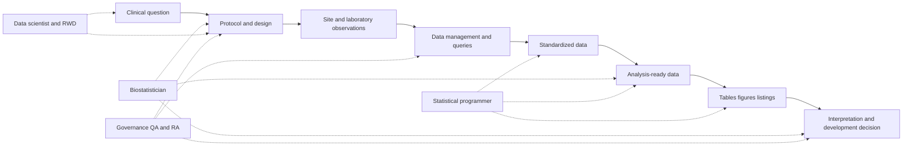

# Roles: responsibilities, outputs, and handoffs

This is a teaching model, not a universal organizational chart. Titles and task allocation vary; a small biotech may combine roles, while a sponsor and CRO may divide them. Tool choice does not define a profession. The sponsor and investigator retain applicable oversight responsibilities when activities are delegated. [ICH E6(R3) overview](https://admin.ich.org/sites/default/files/inline-files/ICH_E6%28R3%29_Step%204_Presentation_2025_0123.pdf)

## Four core roles

| Role | Main question | Typical outputs | Main collaborators |
| --- | --- | --- | --- |
| Biostatistician | What design and analysis can answer the clinical question? | Statistical protocol input, sample-size rationale, analysis plan, interpretation | Clinical team, data manager, programmer, RA |
| Data scientist | What can additional or exploratory data tell us, and what should we investigate next? | Exploration, feasibility estimates, predictive models, RWD analyses | Clinical experts, biostatistician, governance, engineering |
| Statistical programmer | Can the planned analysis be implemented reproducibly and traced to source data? | Standardized/analysis datasets, TFLs, code and output checks | Biostatistician, data manager, standards specialists |
| Data manager | Are collected observations complete enough, consistent, and usable for the planned study? | Data-collection specification, validation/query workflow, reconciliation and cleaned database | Sites, CRA, lab/vendor teams, biostatistician, programmer |

Biostatisticians work on trial design and planned inference; data scientists often work on exploration or RWD informing design. Both can contribute to either. Statistical programming involves domain reasoning, not merely executing software. Data managers cannot invent values that sites never collected.

## Supporting roles: recognize the interface

| Role | Practical responsibility | Example contribution |
| --- | --- | --- |
| Data governance | Agree data ownership/stewardship, permitted uses, access, definitions, and lifecycle | Determines who may access linked hospital data and for what purpose |
| Quality assurance (QA) | Assess and support reliable quality processes and adherence to agreed procedures | Reviews whether issue handling and controls are effective |
| Regulatory affairs (RA) | Plan regulatory strategy, coordinate authority interactions, and organize submissions | Clarifies what evidence the product claim and pathway require |
| Investigator and site team | Conduct the study locally and make clinical assessments under the protocol | Record the visit and investigate a missing sample |
| Clinical research associate (CRA) | Monitor study conduct and support site follow-up | Follows up the data query with the site |
| Clinical operations | Coordinate delivery across sites, vendors, and study activities | Resolves a laboratory-shipping problem |

Data governance is a set of responsibilities that can span teams, not necessarily a single job. Privacy, legal, information-security, and medical/safety specialists are collaborators rather than duties automatically owned by a statistician.

## Shared workflow

The arrows are explanatory handoffs; they are not an exhaustive responsibility matrix or a claim that work occurs only once. Data queries may return to the site; analysis requirements should influence collection design before recruitment starts.

## A missing laboratory result: instructor demonstration

1. Show the missing day-30 Lp(a) record for **EDU-LPA-007** in the synthetic LB file. A blank result is not zero.
2. The data manager detects it and asks the site/lab to establish whether the sample was taken, processed, or lost. The CRA or operations team helps follow up. Clinical staff assess any patient-safety implications.
3. If no valid result exists, preserve its missing status and reason. The programmer applies the agreed rules and makes denominators visible; the biostatistician considers the implications for the clinical question and planned analysis.
4. Governance controls who sees patient-linked source information. QA examines recurring process failures; RA may need the consequences explained if they affect the evidence package. Not every individual query requires a QA audit or an RA decision.

This fictional scenario describes typical collaboration; it does not attribute those activities to specific people in the SLN360 trial.
