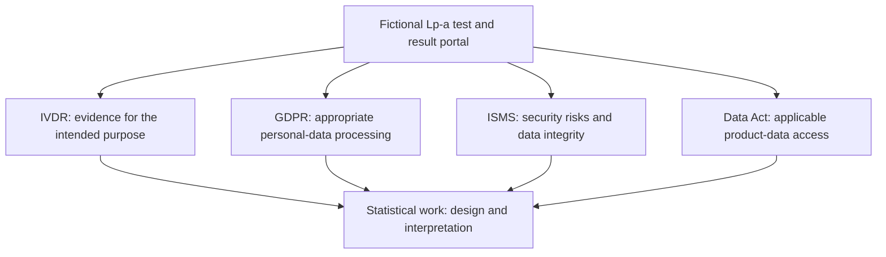

# Session 3 — Diagnostics and the EU data context

**Duration:** 120 minutes, including presentations and a ten-minute break. **Outcome:** distinguish a diagnostic evidence question from a treatment question, and recognize privacy, security, and data-access interfaces.

| Minutes | Content |
| --- | --- |
| 0–30 | Three student presentations |
| 30–50 | Drug versus diagnostic product |
| 50–60 | Break |
| 60–85 | Four-framework map |
| 85–100 | Cross-team scenario |
| 100–120 | Final synthesis, post-class survey, optional topics |

The named frameworks provide supporting context. Keep the explanation tied to what a statistician needs to ask and whom to involve.

## Slide 1 — From changing biology to measuring it

**Slide text**

- A drug trial asks about the effects of an intervention.
- A diagnostic product makes a measurement or information claim.
- The product claim determines the evidence question.

**Instructor notes**

Introduce [CardioLab Connect](case-study.md#separate-fictional-diagnostic-product), a fictional Lp(a) assay and result portal. It is separate from SLN360. Explain the difference between measuring a biomarker and demonstrating that a treatment changes patient outcomes. A test that reports a concentration does not automatically have evidence to claim it predicts a future event or identifies responders to a particular drug.

## Slide 2 — Intended use comes before the analysis

**Slide text**

- What is measured, in whom, and for what purpose?
- Who uses the result, in which setting?
- What is the appropriate comparator and uncertainty?

**Instructor notes**

Use the case's numeric result delivered to healthcare professionals. Contrast that with an added individualized risk score: the statistical and evidence questions would change. Do not guess the device class or classify the portal solely because it shows medical data. [IVDR intended purpose and classification](https://eur-lex.europa.eu/eli/reg/2017/746/oj/eng)

## Slide 3 — IVDR: three evidence questions

**Slide text**

| Evidence area | Plain-language question |
| --- | --- |
| Scientific validity | Is the analyte meaningfully associated with the claimed clinical context? |
| Analytical performance | Does this test measure it appropriately? |
| Clinical performance | Do its results support the intended clinical purpose? |

**Instructor notes**

Use a repeatability example rather than teaching a full performance-study design. Students already know variation: now ask whether it comes from the sample, instrument, site, or measurement process. A known biomarker association is not evidence that a new assay measures accurately. Evidence requirements follow intended purpose. These concepts are summarized in [MDCG 2022-2](https://health.ec.europa.eu/system/files/2022-01/mdcg_2022-2_en.pdf); performance evaluation is addressed by [IVDR Article 56 and Annex XIII](https://eur-lex.europa.eu/eli/reg/2017/746/oj/eng).

## Slide 4 — GDPR: useful data are not automatically usable data

**Slide text**

- Health data need an appropriate purpose and processing arrangement.
- Coded data can still be personal data.
- Ask who may access which data and for what purpose.

**Instructor notes**

Keep legal articles off the teaching slide. Explain that applicable lawful-processing conditions must be established with the controller/privacy team; participant consent is not blanket permission for every future use. Pseudonymization is not the same as anonymization. The statistician can minimize requested variables and avoid exposing identities in outputs. [GDPR](https://eur-lex.europa.eu/eli/reg/2016/679/oj/eng), [EDPB research guidance response](https://www.edpb.europa.eu/sites/default/files/files/file1/edpb_replyec_questionnaireresearch_final.pdf)

## Slide 5 — ISMS: protect confidentiality, integrity, availability

**Slide text**

- Confidentiality: appropriate people can access the data.
- Integrity: results and transformations remain trustworthy.
- Availability: authorized work can continue when needed.
- ISO/IEC 27001 is an ISMS reference, not clinical-performance evidence.

**Instructor notes**

Show familiar examples: controlled exports, versioned datasets, backup/recovery, and records of changes. Explain that an ISMS has a defined organizational scope. Do not teach certification, controls catalogs, or audit procedures. A certificate cannot establish that the assay is clinically useful. [ISO/IEC 27001 official overview](https://www.iso.org/standard/27001)

## Slide 6 — EU Data Act: access and interpretation

**Slide text**

- Some connected-product data have user-access and sharing rules.
- Establish which product, service, user, and data are involved.
- Data-access rights do not erase privacy requirements.

**Instructor notes**

Ask whether a communicating analyzer and its portal fall within relevant provisions; do not conclude merely from the word “connected.” Explain why units, timestamps, and provenance matter to someone receiving an authorized export. Do not equate all patient records or all derived scores with covered product data. The Act generally applies from 12 September 2025; a later date applies to the specified design obligation. Detailed applicability and dates are in the optional [research note](../research/eu-diagnostic-frameworks.md). [Commission explanation](https://digital-strategy.ec.europa.eu/en/factpages/data-act-explained), [Data Act](https://eur-lex.europa.eu/eli/reg/2023/2854/oj/eng)

## Slide 7 — One product, four questions

**Slide text**

**Instructor notes**

This is a map of questions, not proof that every framework applies identically. Point to the collaborators: manufacturer/study team and RA for evidence strategy; controller/privacy team for processing; security owners for ISMS; relevant legal/product teams for access obligations. The statistician contributes evidence and interpretable data, not all legal determinations. EMA has specific device-related roles, but is not the general EU device regulator. [EMA device overview](https://www.ema.europa.eu/en/human-regulatory-overview/medical-devices)

## Slide 8 — A proposed new use

**Slide text**

- A data scientist proposes exploring hospital test results for recruitment feasibility.
- The biostatistician asks how eligibility is defined.
- Governance/privacy and security teams check access and use.
- Data management/programming teams make the authorized data interpretable.

**Instructor notes**

Use this as an instructor-led discussion. Ask what changes if the portal also proposes a clinical risk score. Keep the answer high-level: new use/claim, appropriate evidence, processing purpose, security and access scope. QA examines relevant quality processes; RA helps align the claim and pathway. Do not pretend this example settles classification or legal permission. This scenario connects the core roles rather than adding a compliance workshop.

## Slide 9 — Digital data add opportunities and practical questions

**Slide text**

- Remote participation changes collection logistics.
- Wearable/sensor data bring timing, missingness, and measurement questions.
- A stream is not automatically a validated endpoint.

**Instructor notes**

Spend only two or three minutes here to retain syllabus context. A patient's home measurement can miss data for technical and behavioral reasons. Device-version changes and time alignment can affect interpretation. Do not imply a consumer wearable, an IVD assay, and medical-device software share one classification or pathway. The course's main device case remains the diagnostic product.

## Final synthesis and survey

Ask: “A study suggests a biomarker change, one lab result is missing, and a related diagnostic team proposes a research export. Which questions belong to the core roles, what collaborators are needed, and what conclusions are still unsupported?” Allow about five minutes. Use the [answer guide](answers.md#final-integrative-discussion).

Two brief checks: (1) Is a coded test-result dataset necessarily anonymous? (2) Does an information-security certificate establish clinical performance? Then allow three to four minutes for the [post-class survey](post-class-survey.md). Offer [three optional follow-up topics](presentations.md#after-session-3) without scheduling a fourth class.

## References for this session

The [EU research note](../research/eu-diagnostic-frameworks.md) collects the official IVDR, GDPR, ISO, Data Act, EMA, and MDCG references and their applicability limits. Checked 2026-10-11. This lesson teaches role awareness and evidence questions; it does not determine obligations for a real product.
