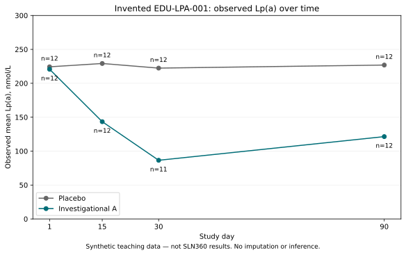

# Generated TFL examples — EDU-LPA-001

**Invented teaching data. Not SLN360 results.** All 24 participants received their assigned invented intervention; each arm has 12.

## Table 1 — Participant characteristics

| Arm | N | Age mean (SD), years | Female n (%) | Baseline Lp(a) median, nmol/L |
| --- | --- | --- | --- | --- |
| Placebo | 12 | 51.7 (10.5) | 4 (33.3%) | 223 |
| Investigational A | 12 | 54.5 (10.7) | 4 (33.3%) | 216 |

Descriptive summaries; the table is not a balance test. SD uses the sample definition. Baseline is observed for everyone.

## Table 2 — Recorded adverse events

| Arm | Event term | Participants n (%) | Event records |
| --- | --- | --- | --- |
| Placebo | Any recorded event | 2/12 (16.7%) | 2 |
| Placebo | Headache | 1/12 (8.3%) | 1 |
| Placebo | Injection site discomfort | 0/12 (0.0%) | 0 |
| Placebo | Nausea | 0/12 (0.0%) | 0 |
| Placebo | Rash | 1/12 (8.3%) | 1 |
| Investigational A | Any recorded event | 4/12 (33.3%) | 5 |
| Investigational A | Headache | 1/12 (8.3%) | 2 |
| Investigational A | Injection site discomfort | 2/12 (16.7%) | 2 |
| Investigational A | Nausea | 1/12 (8.3%) | 1 |
| Investigational A | Rash | 0/12 (0.0%) | 0 |

Counts refer to participants with at least one recorded event; repeated events count once per participant per term. The event-record column counts all records. All events are after dosing and mild; none are serious in this invented dataset. These are plain-language terms, not MedDRA-coded preferred terms. No safety-equivalence or causal conclusion is intended.

## Figure 1 — Observed Lp(a) over time

| Arm | Visit | Observed n | Mean Lp(a), nmol/L |
| --- | --- | --- | --- |
| Placebo | BASELINE | 12 | 224.3 |
| Placebo | DAY 15 | 12 | 229.2 |
| Placebo | DAY 30 | 12 | 222.4 |
| Placebo | DAY 90 | 12 | 226.9 |
| Investigational A | BASELINE | 12 | 220.7 |
| Investigational A | DAY 15 | 12 | 143.4 |
| Investigational A | DAY 30 | 11 | 86.5 |
| Investigational A | DAY 90 | 12 | 121.4 |

Observed-case descriptive means: no imputation, confidence intervals, or treatment-effect estimation. Day 30 has one missing active-arm result. Do not read a changing observed-case mean as an unbiased causal estimate.

## Listing 1 — Example participant laboratory records

| Participant | Arm | Visit | Lp(a), nmol/L | Status |
| --- | --- | --- | --- | --- |
| EDU-LPA-003 | Investigational A | BASELINE | 201.0 | Observed |
| EDU-LPA-003 | Investigational A | DAY 15 | 132.7 | Observed |
| EDU-LPA-003 | Investigational A | DAY 30 | 82.4 | Observed |
| EDU-LPA-003 | Investigational A | DAY 90 | 112.6 | Observed |
| EDU-LPA-007 | Investigational A | BASELINE | 269.0 | Observed |
| EDU-LPA-007 | Investigational A | DAY 15 | 174.8 | Observed |
| EDU-LPA-007 | Investigational A | DAY 30 | — | Not done: specimen not available |
| EDU-LPA-007 | Investigational A | DAY 90 | 148.0 | Observed |

Selected participants only, not the whole study. A dash means no observed value, not zero.
